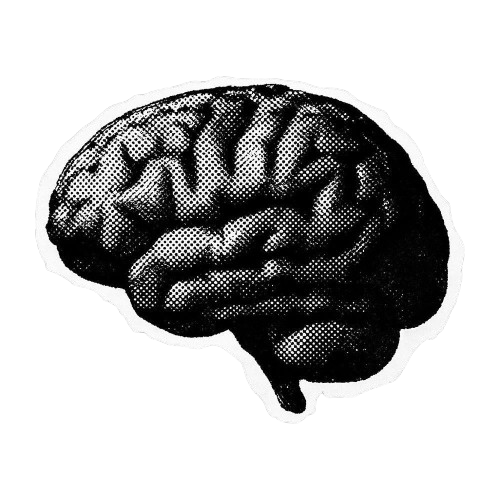
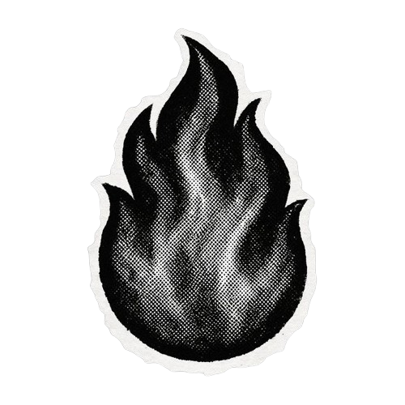

  <h2>About Me</h2>

<h3>✦ E aí! Eu sou o Neves</h3>

Estudante de Engenharia de Software (UNIFSA) com foco em Ciência de Dados. Estudo Python, estatística, bancos de dados, visualização e Machine Learning para criar soluções escaláveis orientadas por dados.

 

<h3>✦ Contatos</h3>

 

&nbsp;<a href="mailto:neveszr12@gmail.com">neveszr12@gmail.com</a>

 

> *“Keep Moving Forward.”*  
> — Walt Disney

 
 
